# 🌱 BitácoraAgro

Sistema de **trazabilidad agrícola** para pequeños productores. El productor registra su producción (parcelas → lotes → labores → cosecha) y el sistema genera un **certificado con código SHA-256 y QR**. Cualquier persona escanea el QR, ve el historial completo y comprueba que **nadie lo modificó**. Los compradores registrados **califican** al productor y construyen su reputación.

Hecho con arquitectura **MVC**. Es responsive (computador, tablet y celular desde el navegador).

| Inicio de sesión | Panel del productor |
|---|---|
| 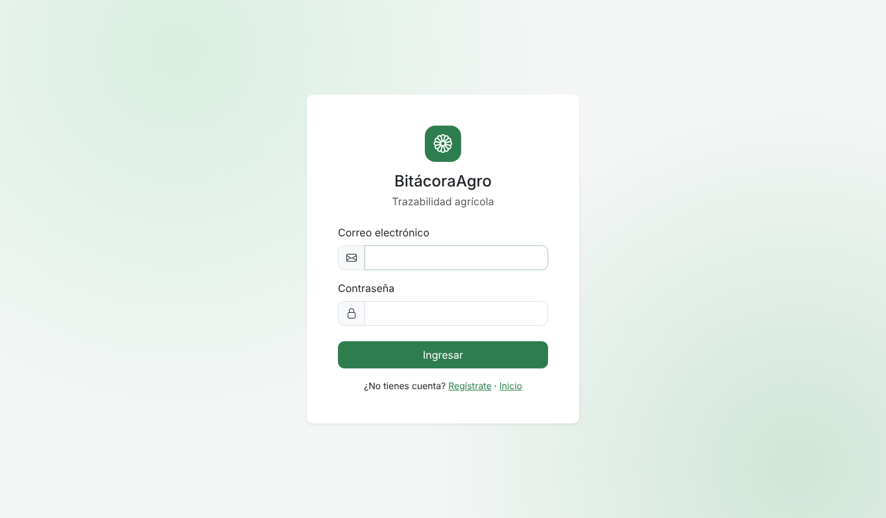 | 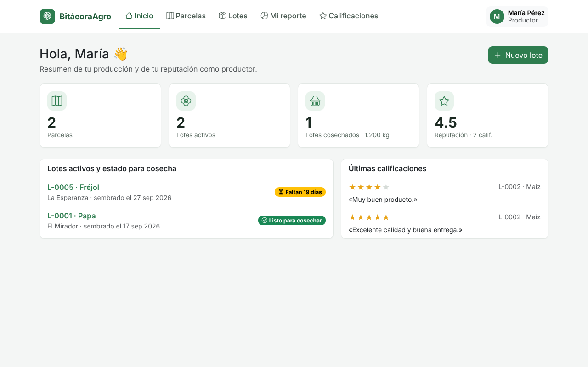 |

🔗 **Sitio desplegado:** _(pega aquí la URL de Render)_
🎥 **Video explicativo:** _(pega aquí el enlace de Loom/YouTube)_

---

## 👥 Roles

| Rol | Qué puede hacer |
|---|---|
| **Administrador** | Gestiona usuarios, cultivos e insumos (con sus días de carencia), y también parcelas, lotes y labores. Ve las estadísticas generales. |
| **Productor** | CRUD de sus parcelas · crea lotes en sus parcelas · registra, edita y borra labores mientras el lote esté activo · registra la cosecha · genera el certificado con QR · ve su reporte por rango de fechas · ve sus calificaciones y su reputación. |
| **Comprador** | Consulta sin iniciar sesión (QR o código) · se registra e inicia sesión · califica un lote certificado **una sola vez** (1 a 5 estrellas + comentario opcional) · ve sus calificaciones. |
| **Visitante** (sin cuenta) | Abre la página pública `/t/CÓDIGO` y verifica el certificado. No ve datos personales. |

---

## 🔄 Cómo funciona el core (reglas del Documento de Análisis)

| # | Regla | Cómo se aplica | Dónde está |
|---|---|---|---|
| a | **Validar labores** | Solo si el lote está **activo**, la fecha no es anterior a la siembra ni posterior a hoy; abonado y fumigación exigen insumo | `validarLabor` |
| b | **Fecha de liberación** | = mayor `fecha de la labor + días de carencia` entre las labores con agroquímico (sin agroquímicos: la siembra) | `fechaLiberacion` |
| c | **Validar la cosecha** | Si la fecha es anterior a la liberación se **rechaza y dice cuántos días faltan**. Si es válida, se registra y el lote se **cierra** (sus labores quedan bloqueadas) | `validarCosecha`, `registrarCosecha` |
| d | **Certificado** | Hash **SHA-256** del historial (código, cultivo, parcela, siembra, labores ordenadas y cosecha) + **código público único** `BA-XXXX-XXXX` + **QR** | `generarCertificado` |
| e | **Verificación pública** | La página pública **recalcula el hash en ese momento**: «Verificado» si coincide o **alerta roja** si alguien cambió la base de datos | `verificarCertificado` |
| f | **Calificación y reputación** | Solo comprador registrado, solo lotes con certificado, una vez por lote. Reputación = suma de puntajes / total (sin calificaciones: «No disponible»). El productor **no puede editar ni borrar** calificaciones | `validarCalificacion`, `reputacionProductor` |
| g | **Reportes y estadísticas** | Por rango de fechas: del productor (lotes, kg, labores, promedio) y globales del administrador (lotes, kg, por cultivo, ranking, promedio) | `estadisticas.js` |

Todas estas reglas viven en **un solo archivo**, `src/core/reglas.js`, y se ejecutan en el servidor.

**Reglas de acceso:** cada productor solo ve y modifica **sus** parcelas, lotes, labores y certificados (si pide el id de otro, responde 404) · un lote solo se crea en una parcela propia · el certificado solo existe para lotes cosechados · la página pública muestra solo el nombre corto del productor («María P.»), nunca correo ni datos personales.

| Cosecha bloqueada por carencia | Certificado con QR |
|---|---|
| 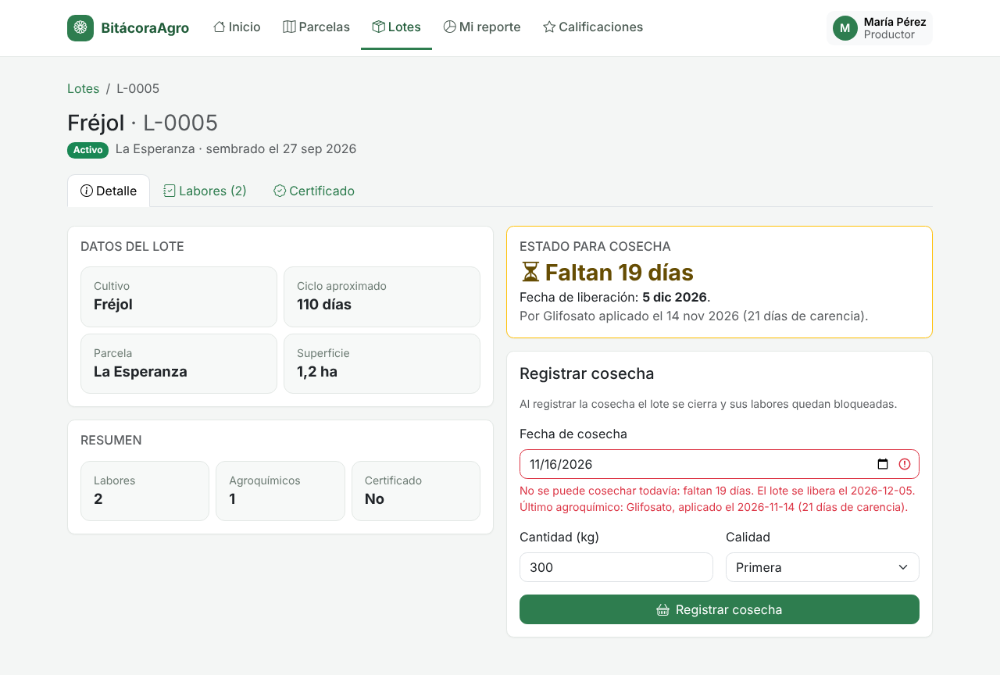 | 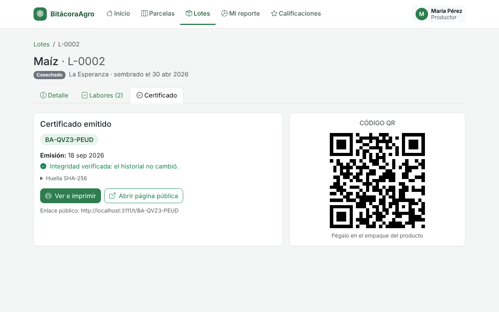 |

| Página pública (celular) | Si alguien altera los datos |
|---|---|
| 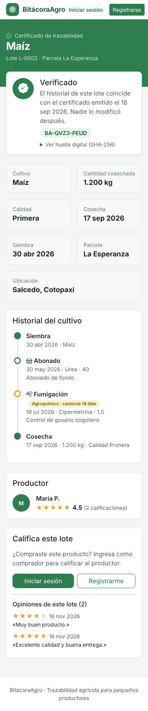 | 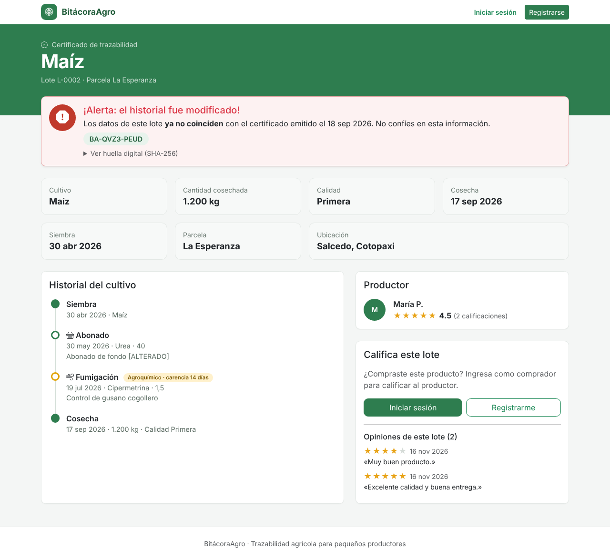 |

---

## ✅ Requisitos del deber (administración MVC)

### 1. Validaciones en el Back-End de datos sensibles
El servidor valida **siempre antes de guardar**, no solo el JavaScript del navegador:

| Dato sensible | Reglas que aplica el servidor | Dónde está |
|---|---|---|
| **Días de carencia** del insumo (seguridad alimentaria) | Un agroquímico debe tener entre 1 y 365 días; pesticidas, fungicidas y herbicidas deben marcarse como agroquímico; solo enteros | `src/catalogos/insumos.js` |
| **Fecha de la labor** (integridad del historial) | Fecha real; no anterior a la siembra; no posterior a hoy; lote activo; abonado y fumigación exigen insumo | `src/core/reglas.js` |
| **Credenciales** (correo y contraseña) | Correo válido y único; contraseña de 8+ caracteres con mayúsculas, minúsculas y números; se guarda con bcrypt | `src/lib/validators.js` |

Si algo no cumple, el servidor responde **422** y no guarda nada, aunque alguien salte el formulario (por ejemplo con `fetch` desde la consola).

| Días de carencia | Fecha de la labor |
|---|---|
| 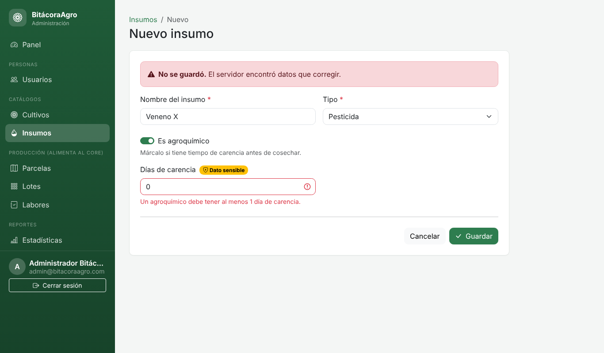 | 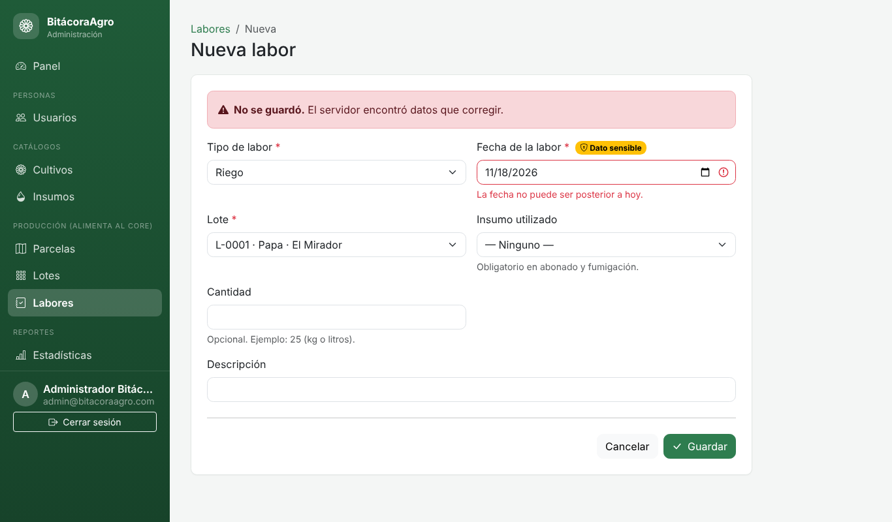 |

### 2. Dropdowns para referencias a otras tablas, y en cascada
Ningún campo que apunta a otra tabla es un input libre: todos son `<select>` cargados desde la base de datos.

- **Cascada Productor → Parcela** al crear un lote como administrador: al elegir el productor, el dropdown de parcelas carga **solo las de ese productor** (`GET /admin/api/productores/:id/parcelas`).
- **El servidor no confía en el dropdown:** comprueba que cada id exista y que la parcela pertenezca al productor elegido; si no, responde 422.

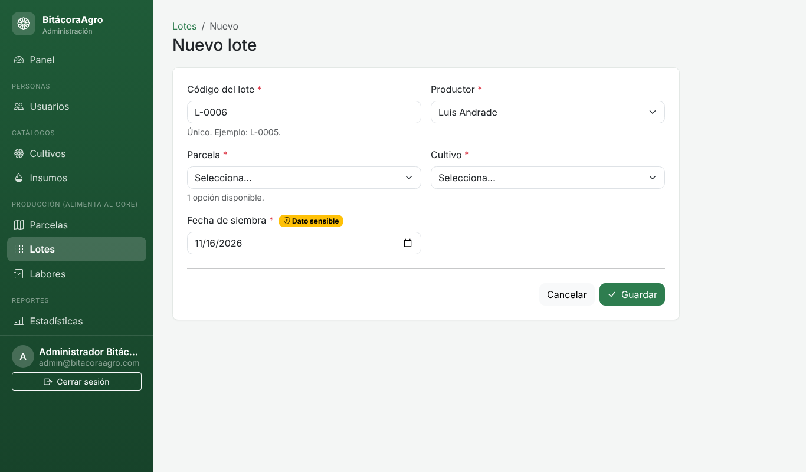

### 3. Git + README + Deploy
Código versionado en Git, este README y despliegue en Render (secciones al final).

---

## 🧱 Arquitectura MVC

| Capa | Dónde está | Qué hace |
|---|---|---|
| **Modelo** | `src/db/` (esquema, conexión, datos de prueba), `src/core/reglas.js` (reglas del core) y `src/catalogos/` (reglas de cada módulo del administrador) | Datos y reglas de negocio |
| **Vista** | `src/views/` (EJS) + `public/` (CSS/JS) | Páginas HTML con Bootstrap 5, responsivas |
| **Controlador** | `src/controllers/` | `auth` (login y registro), `productor`, `comprador`, `publico` (QR y calificar), `dashboard` y `crud` (administración), `estadisticas` |

```
bitacora-agro/
├── src/
│   ├── app.js               # Fastify: sesión, CSRF, permisos por rol
│   ├── server.js            # Arranque
│   ├── menus.js             # Menú de cada rol
│   ├── core/reglas.js       # ⭐ Reglas del core (labores, carencia, cosecha, hash, calificaciones)
│   ├── controllers/         # auth, productor, comprador, publico, dashboard, crud, estadisticas
│   ├── catalogos/           # Módulos del administrador (usuarios, cultivos, insumos, parcelas, lotes, labores)
│   ├── db/                  # schema.sql, index.js, seed.js (datos de prueba)
│   ├── lib/                 # validators.js, vistas.js (ayudas de plantillas)
│   └── views/               # layouts, productor/, comprador/, publico/, crud/
├── public/                  # css/app.css y js/app.js
├── scripts/alterar-lote.js  # Demostración: simular que alguien altera la base de datos
├── test/                    # 58 pruebas automáticas
├── docs/                    # Capturas
├── render.yaml              # Configuración de despliegue
└── package.json
```

## 🛠️ Tecnologías

Node.js 22+ · Fastify 5 · SQLite (better-sqlite3) · EJS · Bootstrap 5 · bcryptjs · qrcode · `node:test`

## 🔐 Seguridad incluida

- Contraseñas con **bcrypt**; sesión con cookie `HttpOnly` y `SameSite`; la sesión se regenera al iniciar sesión.
- **Token CSRF** en todos los formularios.
- **Permisos por rol:** cada zona (`/admin`, `/productor`, `/comprador`) solo admite su rol, y el rol se vuelve a comprobar en la base de datos en cada petición (si desactivan al usuario, pierde el acceso al instante).
- **Cada productor solo accede a lo suyo** (si pide el id de otro, 404).
- Límite de intentos de login (5 fallos → bloqueo de 15 minutos). El administrador **no** se puede auto-registrar.
- Consultas SQL parametrizadas (sin inyección SQL) y salida HTML escapada (sin XSS).
- **Integridad referencial:** no se puede borrar lo que otros registros usan (mensaje amigable).
- **Integridad del certificado:** hash SHA-256 verificado en cada visita a la página pública.

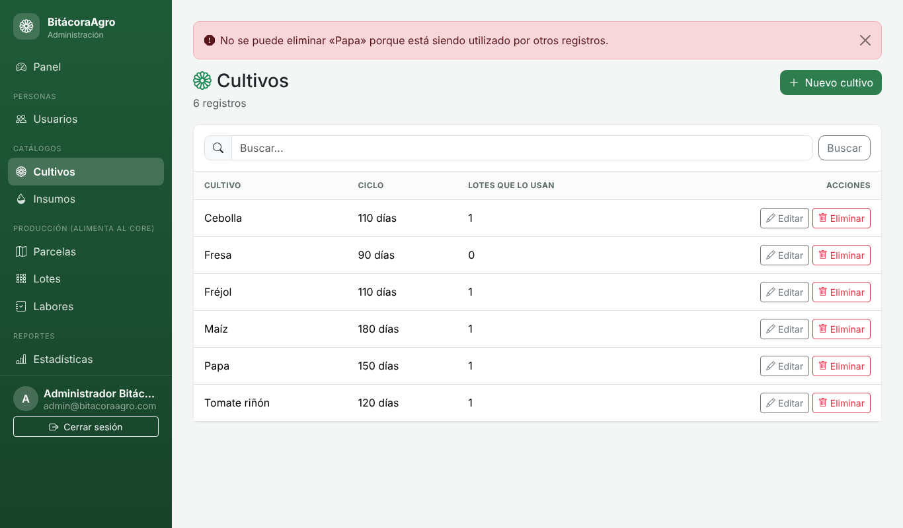

## 📊 Estadísticas y reportes

El administrador ve la producción general por rango de fechas (lotes cosechados, kg, producción por cultivo, ranking de productores y calificación promedio). Cada productor ve **su propio reporte** con el mismo filtro y puede imprimirlo.

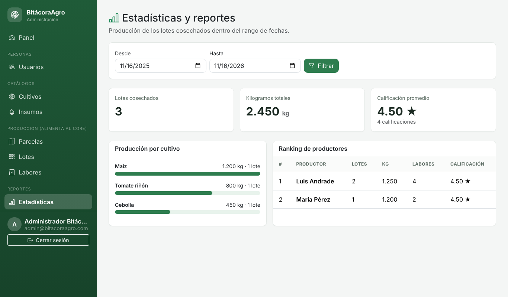

## ▶️ Ejecutar en tu computador

Requisitos: **Node.js 22 o superior** (`node -v` para comprobarlo).

```bash
npm install
npm start
```

Abre <http://localhost:3000>. La primera vez se crea la base de datos (`data/bitacora.db`) con **datos de prueba**.

| Rol | Correo | Contraseña |
|---|---|---|
| Administrador | `admin@bitacoraagro.com` | `Admin123*` |
| Productor 1 (María Pérez) | `productor@bitacoraagro.com` | `Productor123*` |
| Productor 2 (Luis Andrade) | `productor2@bitacoraagro.com` | `Productor123*` |
| Comprador 1 | `comprador@bitacoraagro.com` | `Comprador123*` |
| Comprador 2 | `comprador2@bitacoraagro.com` | `Comprador123*` |

Para empezar de cero, borra la carpeta `data/` y vuelve a ejecutar `npm start`. Modo desarrollo (reinicia solo al guardar): `npm run dev`.

### 🎬 Guía rápida para probarlo (y para el video)

1. **Productor:** entra como `productor@…`. En **Lotes** abre **L-0005 (Fréjol)**: aplicó Glifosato hace 2 días (21 de carencia) → el cuadro dice *«Faltan 19 días»*. Intenta registrar la cosecha: el servidor la **rechaza** y explica por qué.
2. Abre **L-0001 (Papa)**: está **listo para cosechar**. Registra la cosecha → el lote se cierra y sus labores quedan bloqueadas.
3. En la pestaña **Certificado** pulsa **Generar certificado**: aparece el código `BA-XXXX-XXXX`, el SHA-256 y el **QR**.
4. Abre **Abrir página pública** (o escanea el QR con el celular): sale **«Verificado»**.
5. **Manipulación:** en la terminal ejecuta `npm run demo:alterar -- L-0002`, recarga la página pública de ese lote → **alerta roja**. Con `npm run demo:restaurar -- L-0002` vuelve a «Verificado».
6. **Comprador:** entra como `comprador@…` (o regístrate), abre el certificado de otro lote y **califica**. Intenta calificar de nuevo: no deja. Vuelve como productor: la **reputación** se actualizó.
7. **Reportes:** *Mi reporte* (productor) y *Estadísticas* (administrador), filtrando por fechas.

## 🧪 Pruebas

```bash
npm test
```

Hay **58 pruebas automáticas**. Cubren, entre otras: labor con fecha futura/anterior a la siembra/lote cosechado, fecha de liberación y días que faltan, cosecha rechazada por carencia, lote cerrado tras la cosecha, hash SHA-256 que **detecta cualquier alteración**, calificación única por lote, reputación, el **flujo completo** de punta a punta, que cada productor solo accede a lo suyo, permisos por rol, CSRF, límite de intentos, estadísticas, integridad referencial y XSS.

## ⚙️ Variables de entorno

| Variable | Para qué sirve | Por defecto |
|---|---|---|
| `PORT` | Puerto del servidor | `3000` |
| `NODE_ENV` | `production` activa cookies seguras y exige `SESSION_SECRET` | — |
| `SESSION_SECRET` | Clave para firmar la sesión (mínimo 32 caracteres) | aleatoria en desarrollo |
| `ADMIN_EMAIL` / `ADMIN_PASSWORD` | Administrador inicial (solo con base vacía) | `admin@bitacoraagro.com` / `Admin123*` |
| `DATABASE_PATH` | Ubicación del archivo SQLite | `data/bitacora.db` |

---

## 🌿 Subir el código a Git y GitHub

1. Crea un repositorio **vacío** en GitHub (botón **New repository**, sin README ni .gitignore).
2. En la carpeta del proyecto:

```bash
git init
git add .
git commit -m "feat: BitácoraAgro completo (productor, comprador, certificado con QR y calificaciones)"
git branch -M main
git remote add origin https://github.com/TU_USUARIO/bitacora-agro.git
git push -u origin main
```

Si ya tenías el repositorio de la entrega anterior, solo copia los archivos nuevos encima y ejecuta `git add .`, `git commit -m "feat: core completo"` y `git push`. El archivo `.gitignore` ya evita subir `node_modules/` y la base de datos.

## 🚀 Despliegue en Render

1. Entra a <https://render.com> e inicia sesión con tu cuenta de GitHub.
2. **New +** → **Blueprint** → elige el repositorio. Render lee `render.yaml` solo.
3. Cuando pida `ADMIN_PASSWORD`, escribe la contraseña que quieras para el administrador (mínimo 8 caracteres).
4. Pulsa **Apply**, espera a que el estado sea **Live** y abre la URL.

> ⚠️ **Plan gratuito de Render:** el servicio se «duerme» tras 15 minutos sin uso (la primera visita tarda ~50 s) y el disco es temporal: si se reinicia, la base de datos vuelve a los datos de prueba. Para uso real habría que usar un disco persistente o una base de datos administrada.
>
> 📱 **El QR usa la dirección desde la que abres el sitio.** Para que el QR funcione con el celular, genera el certificado desde la URL de Render (no desde `localhost`).

## 📝 Cambios respecto al Documento de Análisis

| Tema | Documento de análisis | Implementación | Por qué |
|---|---|---|---|
| Acceso a datos | Prisma ORM | `better-sqlite3` (SQL directo sobre SQLite) | Más simple, sin paso de generación y con despliegue más fácil. El modelo de datos es el mismo. |
| Alcance del administrador | Usuarios, cultivos, insumos y estadísticas | Además gestiona **parcelas, lotes y labores** | Permite cargar datos del core y demostrar los dropdowns relacionados y en cascada (requisito 2). |
| Qué entra en el hash | Historial del lote | Incluye los **nombres** de cultivo, parcela e insumos | Si se renombra un cultivo, parcela o insumo del catálogo, los certificados que lo usan dejan de verificar. Es intencional: el historial público debe ser el mismo que se certificó. |

El modelo de datos (Usuario, Parcela, Cultivo, Insumo, Lote, Labor, Cosecha, Certificado y Calificación) es el del Diagrama Entidad-Relación del análisis.

---
Proyecto académico — UDLA, Ingeniería de Software.
