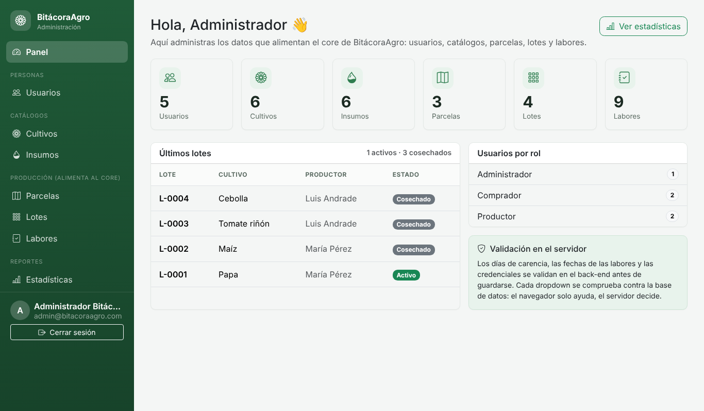
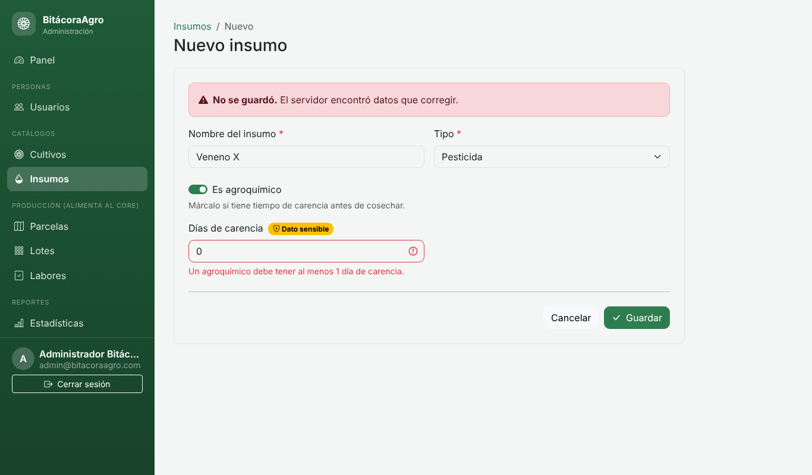
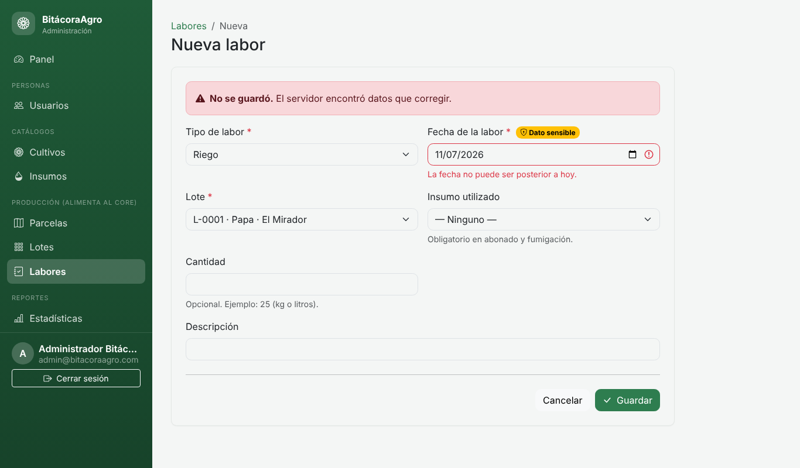
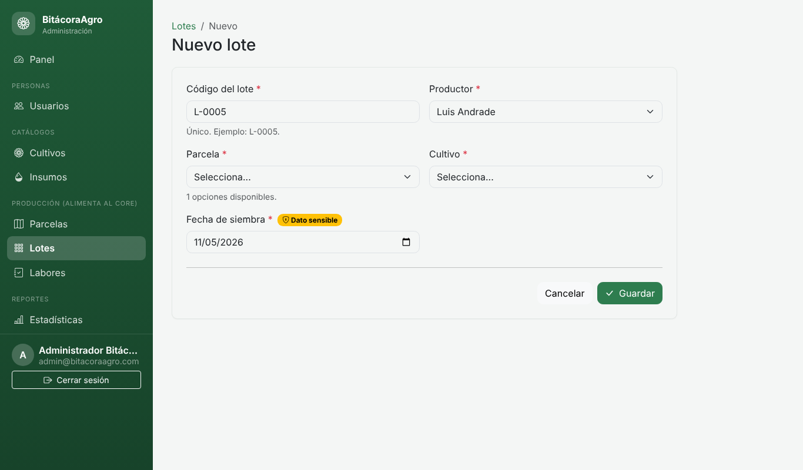
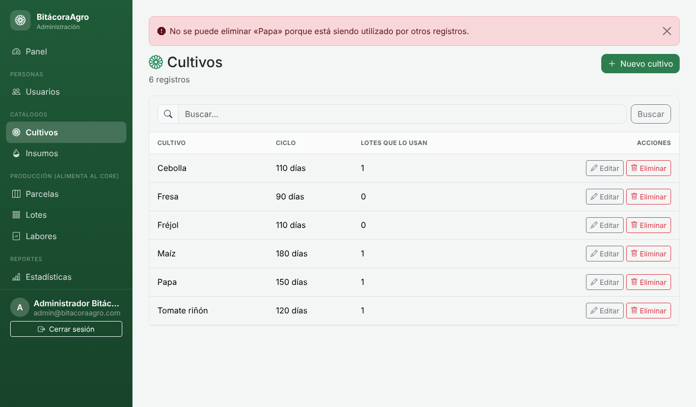
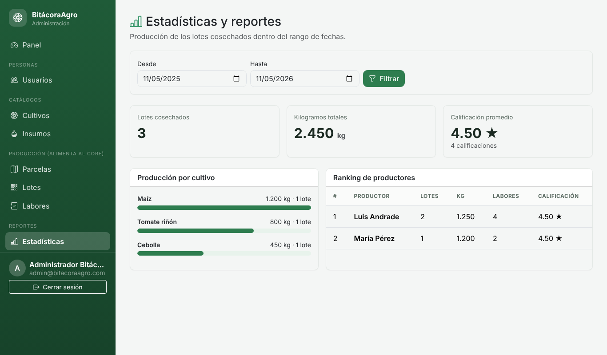

# 🌱 BitácoraAgro — Administración (MVC)

Módulo de **administración** del proyecto core **BitácoraAgro**: un sistema de trazabilidad de la producción de pequeños agricultores (parcelas → lotes → labores → cosechas → certificado con QR → calificación de compradores).

El administrador gestiona los datos que alimentan al core, con las mismas entidades del Diagrama Entidad-Relación del análisis:

| Módulo | Qué administra | Por qué alimenta al core |
|---|---|---|
| **Usuarios** | Administradores, productores y compradores (rol) | Los productores son dueños de parcelas; los compradores califican |
| **Cultivos** | Nombre y ciclo en días | Cada lote se siembra con un cultivo |
| **Insumos** | Tipo, si es agroquímico y **días de carencia** | Las labores usan insumos; la carencia bloquea la cosecha |
| **Parcelas** | Ubicación, hectáreas y productor dueño | Un lote solo existe dentro de una parcela |
| **Lotes** | Código, productor, parcela, cultivo y siembra | Es la unidad de trazabilidad |
| **Labores** | Riego, abonado, fumigación, deshierbe, otro | Son el historial verificable del lote |
| **Estadísticas** | Producción por rango de fechas | Producción total, por cultivo, ranking y calificación promedio |

| Inicio de sesión | Panel |
|---|---|
|  |  |

🔗 **Sitio desplegado:** _(pega aquí la URL de Render)_
🎥 **Video explicativo:** _(pega aquí el enlace de Loom/YouTube)_

---

## ✅ Cumplimiento de los requisitos del deber

### 1. Validaciones en el Back-End de datos sensibles
En BitácoraAgro los datos sensibles son los que garantizan que la trazabilidad sea confiable. El servidor los valida **siempre antes de guardar**, no solo el JavaScript del navegador:

| Dato sensible | Reglas que aplica el servidor | Dónde está |
|---|---|---|
| **Días de carencia** del insumo (seguridad alimentaria) | Un agroquímico debe tener entre 1 y 365 días; pesticidas, fungicidas y herbicidas deben marcarse como agroquímico; solo enteros | `src/catalogos/insumos.js` |
| **Fecha de la labor** (integridad del historial) | Fecha real; no anterior a la siembra; no posterior a hoy; el lote debe estar activo; abonado y fumigación exigen insumo | `src/catalogos/labores.js` |
| **Credenciales** (correo y contraseña) | Correo válido y único (sin importar mayúsculas); contraseña de 8+ caracteres con mayúsculas, minúsculas y números; se guarda con bcrypt | `src/catalogos/usuarios.js`, `src/lib/validators.js` |

Si algo no cumple, el servidor responde **422** y no guarda nada. Aunque alguien salte el formulario (por ejemplo con `fetch` desde la consola del navegador), el servidor igual lo rechaza.

| Días de carencia | Fecha de la labor |
|---|---|
|  |  |

Las fechas de siembra de los lotes, el rol de un usuario, los números (hectáreas, cantidades) y los estados también se validan en el servidor.

### 2. Dropdowns para referencias a otras tablas, y en cascada
Ningún campo que apunta a otra tabla es un input libre. Todos son dropdowns cargados desde la base de datos:

- **Parcela → Productor**, **Lote → Cultivo**, **Labor → Lote** e **Insumo** (opcional).
- **Cascada Productor → Parcela** (en Lotes): al elegir el productor, el dropdown de parcelas se carga solo con **las parcelas de ese productor**, consultando `GET /admin/api/productores/:id/parcelas`. Esto aplica la regla del core *«un lote solo puede crearse en una parcela propia»*.
- **El servidor no confía en el dropdown:** comprueba que cada id exista, que el productor tenga rol Productor y que la parcela pertenezca al productor elegido. Si alguien manipula el formulario, responde 422.



### 3. Git + README + Deploy
Código versionado en Git, este README y despliegue en Render (ver secciones al final).

---

## 🧱 Arquitectura MVC

| Capa | Dónde está | Qué hace |
|---|---|---|
| **Modelo** | `src/db/` (`schema.sql`, `index.js`, `seed.js`) y `src/catalogos/` | Tablas SQLite, datos iniciales y reglas de cada módulo |
| **Vista** | `src/views/` (EJS) + `public/` (CSS/JS) | Páginas HTML con Bootstrap 5, responsivas |
| **Controlador** | `src/controllers/` | `auth.js` (login), `dashboard.js` (panel y API), `crud.js` (CRUD genérico), `estadisticas.js` |

Cada módulo es un archivo de configuración en `src/catalogos/` que describe sus campos y reglas; el controlador `crud.js` hace el resto (listar, crear, editar, eliminar, validar). Agregar un módulo nuevo es agregar un archivo.

```
bitacora-agro/
├── src/
│   ├── app.js              # Configuración de Fastify, sesión, CSRF, permisos
│   ├── server.js           # Arranque
│   ├── controllers/        # auth, dashboard, crud, estadisticas
│   ├── catalogos/          # usuarios, cultivos, insumos, parcelas, lotes, labores
│   ├── db/                 # schema.sql, index.js, seed.js
│   ├── lib/validators.js   # Validaciones de datos sensibles y fechas
│   └── views/              # layouts, login, panel, estadísticas, crud/list, crud/form
├── public/                 # css/app.css y js/app.js
├── test/                   # Pruebas automáticas
├── docs/                   # Capturas
├── render.yaml             # Configuración de despliegue
└── package.json
```

## 🛠️ Tecnologías

Node.js 22+ · Fastify 5 · SQLite (better-sqlite3) · EJS · Bootstrap 5 · bcryptjs · `node:test`

## 🔐 Seguridad incluida

- Contraseñas con **bcrypt** (nunca en texto plano).
- Sesión con cookie `HttpOnly` y `SameSite`; la sesión se regenera al iniciar sesión.
- **Token CSRF** en todos los formularios.
- Solo el rol **ADMINISTRADOR** entra a `/admin`; el rol se vuelve a comprobar en la base de datos en cada petición.
- Límite de intentos de login (5 fallos → bloqueo de 15 minutos).
- Consultas SQL parametrizadas (sin inyección SQL) y salida HTML escapada (sin XSS).
- **Integridad referencial:** no se puede borrar un cultivo, insumo, parcela, productor o lote que otros registros usen (mensaje amigable en vez de error).
- **Reglas del core:** las labores de un lote cosechado quedan bloqueadas (no se crean ni se eliminan).



## 📊 Estadísticas

El administrador consulta la producción dentro de un rango de fechas: lotes cosechados, kilogramos totales, producción por cultivo, ranking de productores (lotes, kg, labores y calificación promedio) y calificación promedio global. El rango se valida en el servidor.



## ▶️ Ejecutar en tu computador

Requisitos: **Node.js 22 o superior** (`node -v` para comprobarlo).

```bash
npm install
npm start
```

Abre <http://localhost:3000>. La primera vez se crea la base de datos (`data/bitacora.db`) con datos de ejemplo (usuarios, cultivos, insumos, parcelas, lotes con labores, cosechas y calificaciones).

| Rol | Correo | Contraseña |
|---|---|---|
| Administrador | `admin@bitacoraagro.com` | `Admin123*` |
| Productor (demo) | `productor@bitacoraagro.com` | `Productor123*` |
| Comprador (demo) | `comprador@bitacoraagro.com` | `Comprador123*` |

Solo el administrador puede entrar al panel. Para empezar de cero, borra la carpeta `data/` y vuelve a ejecutar `npm start`. Modo desarrollo (reinicia solo al guardar): `npm run dev`.

## 🧪 Pruebas

```bash
npm test
```

Hay 42 pruebas automáticas, entre ellas: agroquímico con 0 días de carencia rechazado (422), labor con fecha futura o anterior a la siembra rechazada, labores bloqueadas en lotes cosechados, parcela que no pertenece al productor elegido (422), token CSRF, permisos por rol, límite de intentos de login, contraseña guardada con hash, cálculo de estadísticas, protección de integridad referencial y escape de XSS.

## ⚙️ Variables de entorno

| Variable | Para qué sirve | Por defecto |
|---|---|---|
| `PORT` | Puerto del servidor | `3000` |
| `NODE_ENV` | `production` activa cookies seguras y exige `SESSION_SECRET` | — |
| `SESSION_SECRET` | Clave para firmar la sesión (mínimo 32 caracteres) | aleatoria en desarrollo |
| `ADMIN_EMAIL` / `ADMIN_PASSWORD` | Administrador inicial (solo con base vacía) | `admin@bitacoraagro.com` / `Admin123*` |
| `DATABASE_PATH` | Ubicación del archivo SQLite | `data/bitacora.db` |

---


## 📝 Cambios respecto al Documento de Análisis

| Tema | Documento de análisis | Implementación | Por qué |
|---|---|---|---|
| Acceso a datos | Prisma ORM | `better-sqlite3` (SQL directo sobre SQLite) | Más simple, sin paso de generación y con despliegue más fácil. El modelo de datos es el mismo. |
| Alcance del administrador | Usuarios, cultivos, insumos y estadísticas | Además gestiona **parcelas, lotes y labores** | Permite cargar los datos del core y demostrar los dropdowns relacionados y en cascada (requisito 2). |

El modelo de datos (Usuario, Parcela, Cultivo, Insumo, Lote, Labor, Cosecha, Certificado y Calificación) es el del Diagrama Entidad-Relación del análisis. La cosecha, el certificado con QR y la calificación son funciones del core (productor y comprador), no del administrador.

---
Proyecto académico — UDLA, Ingeniería de Software.
